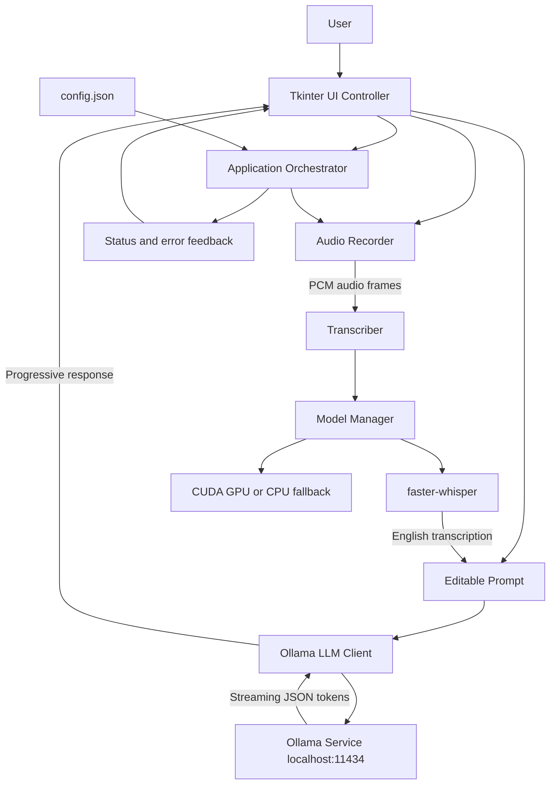

# Parakeet Lite Desktop Assistant

Parakeet Lite is a local-first Windows desktop assistant for converting speech into
questions and generating private, locally hosted answers. Audio is captured from the
microphone, transcribed with faster-whisper, and sent to Ollama for streamed response
generation. No application data is sent to a cloud AI service.

## Features

- Windows desktop UI built with Tkinter
- Microphone recording with a 60-second safety limit
- Live audio-level meter and recording timer
- English speech transcription with faster-whisper
- Lazy model loading and CUDA detection with CPU fallback
- Streaming responses from a local Ollama model
- Automatic DuckDuckGo web search for questions needing current information
- Editable transcription before sending the prompt
- Context-aware transcription improvement using interview role and domain
- Copy and clear actions for generated answers
- JSON configuration with validation
- Graceful shutdown and model resource cleanup
- Keyboard shortcuts for common operations

## Architecture



### Runtime flow

1. The application loads and validates `config.json`.
2. The model manager detects CUDA availability and selects GPU or CPU mode.
3. The orchestrator checks the local Ollama service.
4. **Start recording** captures 16-bit PCM microphone audio.
5. **Stop recording** sends the captured audio to faster-whisper.
6. The transcription appears in an editable prompt area.
7. **Suggest answer** sends the edited prompt to Ollama.
8. Response tokens stream into the answer panel.
9. Shutdown stops recording and unloads the Whisper model.

Each answer request first passes through a local `SearchDiscriminator`. It scores explicit
search requests, freshness signals, and factual lookup intent, while rejecting conceptual
questions such as “How does LangChain work?” or “Explain dependency injection.” Only a
positive discriminator decision invokes the web-search adapter. The retrieved titles,
snippets, and URLs are added to the Ollama prompt for grounded answers with source
citations. Ordinary conceptual questions remain local-only.

### Search decision examples

| Prompt | Search? | Reason |
|---|---:|---|
| `What is the latest LangChain release?` | Yes | Current release information |
| `Search the web for current AI news` | Yes | Explicit web-search request |
| `What is today's weather?` | Yes | Time-sensitive lookup |
| `How does LangGraph work?` | No | Conceptual explanation |
| `Explain dependency injection` | No | General knowledge |
| `Write a FastAPI example` | No | Code-generation request |

The discriminator returns a decision with `should_search`, `confidence`, and `reason`
fields. This keeps search selection deterministic and testable instead of sending every
prompt to a search engine.

### Search provider behavior

The default provider is DuckDuckGo HTML search and does not require an API key. Some
networks return a DuckDuckGo anti-bot challenge rather than search results. In that case,
Parakeet Lite automatically falls back to Bing HTML search and decodes Bing redirect URLs
to the original source URLs. If both providers fail, the application reports a clear
error instead of presenting an answer that appears web-grounded but has no sources.

Search results are formatted as numbered sources:

```text
Web search results:
[1] Source title
URL: https://example.com
Source snippet
```

The Ollama prompt instructs the model to cite these sources as `[1]`, `[2]`, and so on.
Search results are context for the local model; they are not treated as unquestionable
facts, and the model is instructed not to claim that a source says something it does not.
DuckDuckGo search requires an internet connection but no API key.

Before asking for an answer, the prompt panel can optionally improve the transcription.
Enter the interview role, select an interview **Domain** such as Technology, Management,
or Design, and select **Improve**. Ollama corrects punctuation, grammar, homophones, and
likely speech-to-text errors while preserving the original meaning. The result remains
editable and should be reviewed before submission.

## Component responsibilities

| Component | Responsibility |
|---|---|
| `UIController` | Tkinter layout, controls, hotkeys, status indicators, and user feedback |
| `Orchestrator` | Coordinates recording, transcription, response generation, and lifecycle state |
| `AudioRecorder` | Captures microphone PCM data, calculates levels, and enforces the time limit |
| `Transcriber` | Converts PCM audio to a NumPy waveform and runs faster-whisper |
| `LLMClient` | Checks Ollama, sends prompts, and parses streamed JSON responses |
| `SearchDiscriminator` | Decides whether a prompt needs current external information |
| `DuckDuckGoSearch` | Retrieves web results and falls back to Bing when necessary |
| `ModelManager` | Detects GPU hardware, lazily loads Whisper, and releases model resources |
| `ConfigManager` | Reads, validates, and writes JSON configuration |

## Requirements

- Windows 10 or later
- Python 3.10 or later
- Tkinter, included with the standard Windows Python installer
- [Ollama](https://ollama.com/) running locally
- `qwen2.5:3b` or another compatible Ollama model
- A working microphone
- Optional NVIDIA drivers and CUDA-compatible GPU

The application supports CPU-only operation. CUDA is detected automatically and is
not required.

## Setup with uv

Install `uv` if it is not already available:

```powershell
python -m pip install uv
```

Create/synchronize the project environment:

```powershell
cd C:\Nishant\SASTA_PARAKEET
uv sync --extra test --extra audio --extra transcription
```

Install and prepare Ollama:

```powershell
ollama pull qwen2.5:3b
```

Start the application:

```powershell
uv run python -m parakeet_lite.main
```

If `uv` is not on `PATH`, use the installed Windows path:

```powershell
C:\Python314\Scripts\uv.exe sync --extra test --extra audio --extra transcription
C:\Python314\Scripts\uv.exe run python -m parakeet_lite.main
```

Alternatively, run directly with the existing environment:

```powershell
.\.venv\Scripts\python.exe -m parakeet_lite.main
```

The first launch creates the local `config.json` file. It is intentionally ignored by
Git because it contains machine-specific runtime settings.

## Keyboard shortcuts

| Shortcut | Action |
|---|---|
| `Ctrl+R` | Start recording |
| `Ctrl+S` | Stop recording and transcribe |
| `Ctrl+A` | Generate an answer from the current prompt |

## Context-aware transcription

The transcription editor includes two context controls:

- **Interview role**: for example, `Backend Developer`, `Data Analyst`, or `Product Manager`
- **Domain**: `General`, `Management`, `Design`, `Technology`, `Finance`, `Marketing`,
  `Operations`, `Sales`, `Human Resources`, or `Customer Support`

The improvement feature is intentionally conservative. It may correct terms such as
programming languages, frameworks, databases, and cloud services for Technology interviews,
or domain-specific language for other selected domains, when the surrounding sentence and
interview role support the correction. It does not invent answers or facts.

The correction prompt includes a domain terminology guide. Technology interviews use
canonical names such as **LangChain**, **LangGraph**, **LangSmith**, **Hugging Face**,
**OpenAI**, **RAG**, **LLM**, **FastAPI**, **PyTorch**, **PostgreSQL**, **Docker**, and
**AWS**. Other domains use relevant terminology, including:

- **Management**: stakeholder, roadmap, OKR, KPI, prioritization, milestone, Agile, Scrum
- **Design**: UX, UI, usability, accessibility, persona, wireframe, prototype, Figma
- **Finance**: revenue, EBITDA, cash flow, balance sheet, forecast, variance, ROI, audit
- **Marketing**: target audience, buyer persona, conversion rate, funnel, SEO, campaign, A/B testing
- **Operations**: SOP, workflow, throughput, supply chain, procurement, SLA, Six Sigma
- **Sales**: prospect, qualification, pipeline, opportunity, objection handling, quota, CRM
- **Human Resources**: recruitment, onboarding, employee engagement, compensation, payroll
- **Customer Support**: ticket, escalation, SLA, knowledge base, CSAT, NPS, resolution time

These terms are used to repair plausible speech-recognition errors, not to inject
unrelated terminology into the speaker's answer.

## Configuration

The generated `config.json` controls audio, transcription, Ollama, UI, and hotkeys.
Important settings include:

```json
{
  "audio": {
    "sample_rate": 16000,
    "max_duration": 60
  },
  "transcription": {
    "model_name": "base.en",
    "language": "en"
  },
  "llm": {
    "base_url": "http://localhost:11434",
    "default_model": "qwen2.5:3b",
    "stream": true
  },
  "hotkeys": {
    "enabled": true
  }
}
```

Configuration values are validated when the application starts. Invalid values produce
a descriptive startup error instead of silently falling back to unsafe settings.

## Testing

Run the test suite inside the managed environment:

```powershell
uv run pytest
```

The tests cover configuration validation, audio-level calculation, Ollama streaming
parsing, orchestrator lifecycle behavior, and the PCM-to-Whisper transcription handoff.

## Troubleshooting

### `No module named uv`

Use the direct executable path:

```powershell
C:\Python314\Scripts\uv.exe run python -m parakeet_lite.main
```

### Ollama is offline

Start the Ollama desktop application or service, verify that it is listening on
`http://localhost:11434`, and confirm the model is installed:

```powershell
ollama list
ollama pull qwen2.5:3b
```

### Web search is unavailable

Automatic web search uses DuckDuckGo and does not require credentials. Check that the
machine has internet access and that HTTPS requests are allowed by the firewall. If a
question does not need current information, the assistant continues without web search.

The discriminator intentionally does not search every question containing words such as
“what” or “how”. Use an explicit phrase such as **search the web**, **look it up**, or
**find online** when you want to force a web lookup.

### Recording cannot start

Check that Windows has microphone permission enabled for desktop applications and that
a default input device is available. The application uses `sounddevice` on Windows;
PyAudio is not required.

### CUDA is unavailable

The application automatically uses CPU mode. Install current NVIDIA drivers and a
compatible CUDA runtime only if GPU acceleration is needed.

### Whisper model download warnings

faster-whisper downloads the selected model on first use and caches it locally. Windows
may warn that symlinks are unavailable; this is non-fatal and only uses more disk space.

## Project structure

```text
parakeet_lite/
├── audio.py          # Microphone capture and audio-level calculation
├── config.py         # JSON configuration loading and validation
├── llm.py            # Ollama HTTP and streaming client
├── main.py           # Application entry point
├── model_manager.py  # GPU detection and Whisper lifecycle
├── models.py         # Typed application data models
├── orchestrator.py   # Cross-component workflow coordination
├── transcriber.py    # PCM waveform transcription
└── ui.py             # Tkinter desktop interface
tests/                # Unit and integration-style tests with fakes
```

## Packaging

Install PyInstaller and build a Windows executable:

```powershell
uv pip install pyinstaller
uv run pyinstaller --noconfirm --onefile --windowed `
  --name ParakeetLite parakeet_lite\main.py
```

The executable still requires Ollama and its model to be installed separately.
