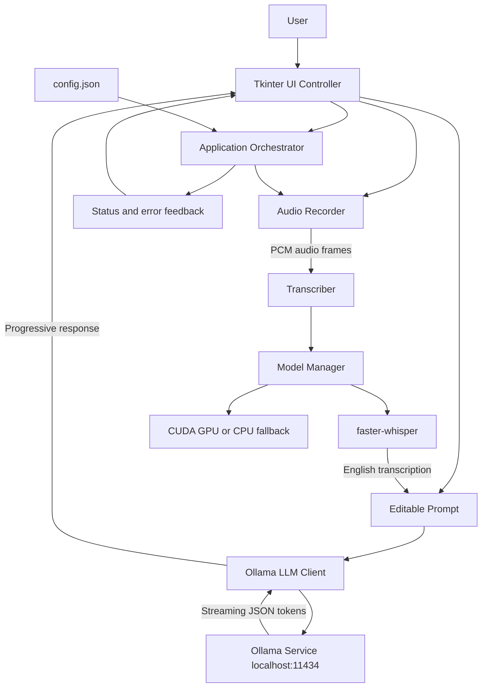

# Parakeet Lite Desktop Assistant

Parakeet Lite is a local-first Windows desktop assistant for converting speech into
questions and generating private, locally hosted answers. Audio is captured from the
microphone, transcribed with faster-whisper, and sent to Ollama for streamed response
generation. No application data is sent to a cloud AI service.

## Features

- Windows desktop UI built with Tkinter
- Microphone recording with a 60-second safety limit
- Live audio-level meter and recording timer
- English speech transcription with faster-whisper
- Lazy model loading and CUDA detection with CPU fallback
- Streaming responses from a local Ollama model
- Editable transcription before sending the prompt
- Copy and clear actions for generated answers
- JSON configuration with validation
- Graceful shutdown and model resource cleanup
- Keyboard shortcuts for common operations

## Architecture



### Runtime flow

1. The application loads and validates `config.json`.
2. The model manager detects CUDA availability and selects GPU or CPU mode.
3. The orchestrator checks the local Ollama service.
4. **Start recording** captures 16-bit PCM microphone audio.
5. **Stop recording** sends the captured audio to faster-whisper.
6. The transcription appears in an editable prompt area.
7. **Suggest answer** sends the edited prompt to Ollama.
8. Response tokens stream into the answer panel.
9. Shutdown stops recording and unloads the Whisper model.

## Component responsibilities

| Component | Responsibility |
|---|---|
| `UIController` | Tkinter layout, controls, hotkeys, status indicators, and user feedback |
| `Orchestrator` | Coordinates recording, transcription, response generation, and lifecycle state |
| `AudioRecorder` | Captures microphone PCM data, calculates levels, and enforces the time limit |
| `Transcriber` | Converts PCM audio to a NumPy waveform and runs faster-whisper |
| `LLMClient` | Checks Ollama, sends prompts, and parses streamed JSON responses |
| `ModelManager` | Detects GPU hardware, lazily loads Whisper, and releases model resources |
| `ConfigManager` | Reads, validates, and writes JSON configuration |

## Requirements

- Windows 10 or later
- Python 3.10 or later
- Tkinter, included with the standard Windows Python installer
- [Ollama](https://ollama.com/) running locally
- `qwen2.5:3b` or another compatible Ollama model
- A working microphone
- Optional NVIDIA drivers and CUDA-compatible GPU

The application supports CPU-only operation. CUDA is detected automatically and is
not required.

## Setup with uv

Install `uv` if it is not already available:

```powershell
python -m pip install uv
```

Create/synchronize the project environment:

```powershell
cd C:\Nishant\SASTA_PARAKEET
uv sync --extra test --extra audio --extra transcription
```

Install and prepare Ollama:

```powershell
ollama pull qwen2.5:3b
```

Start the application:

```powershell
uv run python -m parakeet_lite.main
```

If `uv` is not on `PATH`, use the installed Windows path:

```powershell
C:\Python314\Scripts\uv.exe sync --extra test --extra audio --extra transcription
C:\Python314\Scripts\uv.exe run python -m parakeet_lite.main
```

Alternatively, run directly with the existing environment:

```powershell
.\.venv\Scripts\python.exe -m parakeet_lite.main
```

The first launch creates the local `config.json` file. It is intentionally ignored by
Git because it contains machine-specific runtime settings.

## Keyboard shortcuts

| Shortcut | Action |
|---|---|
| `Ctrl+R` | Start recording |
| `Ctrl+S` | Stop recording and transcribe |
| `Ctrl+A` | Generate an answer from the current prompt |

## Configuration

The generated `config.json` controls audio, transcription, Ollama, UI, and hotkeys.
Important settings include:

```json
{
  "audio": {
    "sample_rate": 16000,
    "max_duration": 60
  },
  "transcription": {
    "model_name": "base.en",
    "language": "en"
  },
  "llm": {
    "base_url": "http://localhost:11434",
    "default_model": "qwen2.5:3b",
    "stream": true
  },
  "hotkeys": {
    "enabled": true
  }
}
```

Configuration values are validated when the application starts. Invalid values produce
a descriptive startup error instead of silently falling back to unsafe settings.

## Testing

Run the test suite inside the managed environment:

```powershell
uv run pytest
```

The tests cover configuration validation, audio-level calculation, Ollama streaming
parsing, orchestrator lifecycle behavior, and the PCM-to-Whisper transcription handoff.

## Troubleshooting

### `No module named uv`

Use the direct executable path:

```powershell
C:\Python314\Scripts\uv.exe run python -m parakeet_lite.main
```

### Ollama is offline

Start the Ollama desktop application or service, verify that it is listening on
`http://localhost:11434`, and confirm the model is installed:

```powershell
ollama list
ollama pull qwen2.5:3b
```

### Recording cannot start

Check that Windows has microphone permission enabled for desktop applications and that
a default input device is available. The application uses `sounddevice` on Windows;
PyAudio is not required.

### CUDA is unavailable

The application automatically uses CPU mode. Install current NVIDIA drivers and a
compatible CUDA runtime only if GPU acceleration is needed.

### Whisper model download warnings

faster-whisper downloads the selected model on first use and caches it locally. Windows
may warn that symlinks are unavailable; this is non-fatal and only uses more disk space.

## Project structure

```text
parakeet_lite/
├── audio.py          # Microphone capture and audio-level calculation
├── config.py         # JSON configuration loading and validation
├── llm.py            # Ollama HTTP and streaming client
├── main.py           # Application entry point
├── model_manager.py  # GPU detection and Whisper lifecycle
├── models.py         # Typed application data models
├── orchestrator.py   # Cross-component workflow coordination
├── transcriber.py    # PCM waveform transcription
└── ui.py             # Tkinter desktop interface
tests/                # Unit and integration-style tests with fakes
```

## Packaging

Install PyInstaller and build a Windows executable:

```powershell
uv pip install pyinstaller
uv run pyinstaller --noconfirm --onefile --windowed `
  --name ParakeetLite parakeet_lite\main.py
```

The executable still requires Ollama and its model to be installed separately.
